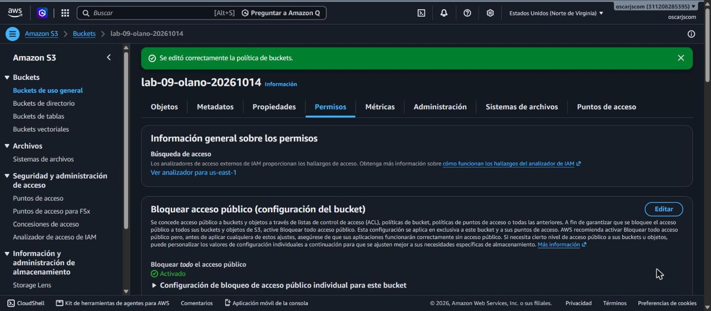
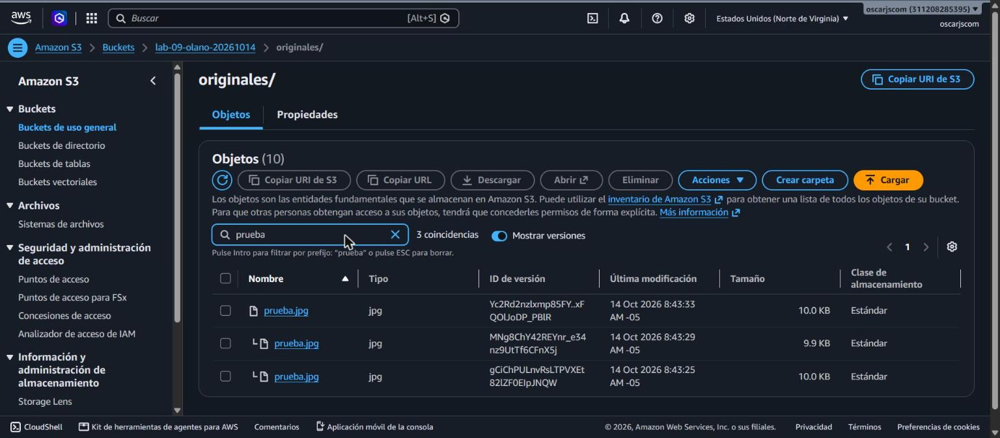
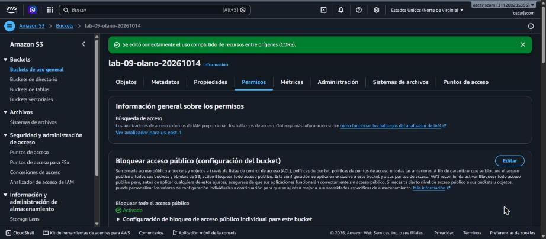
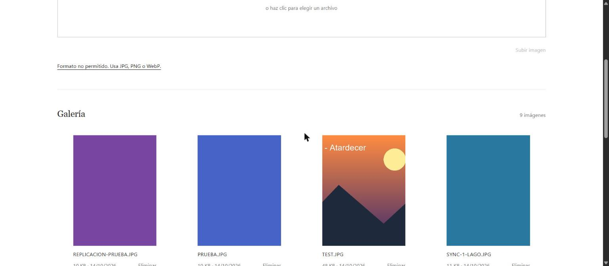
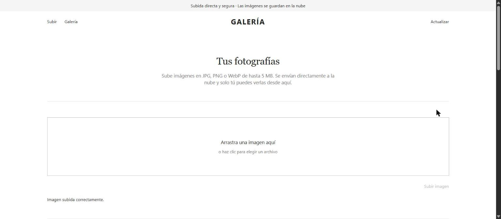
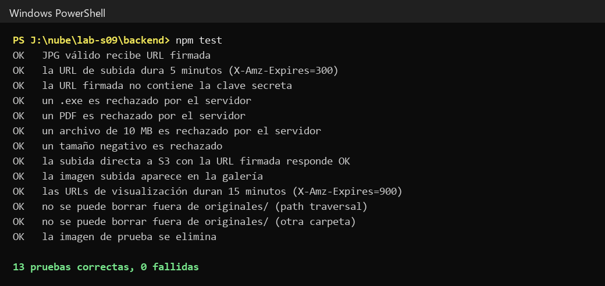
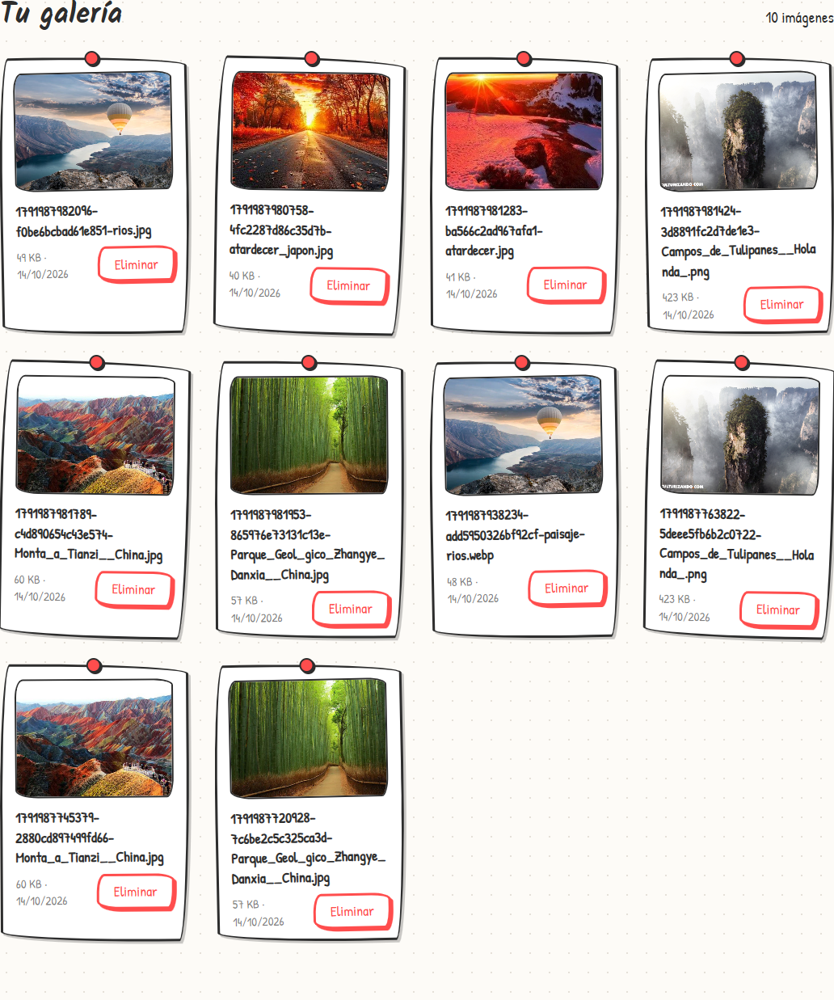
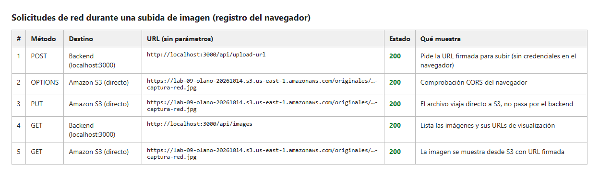

# Semana 09 — Cloud Storage (S3)

**Laboratorio GLAB-S09:** bucket privado en Amazon S3, IAM con mínimo privilegio, versionado y galería web con URLs prefirmadas.

| | |
|---|---|
| **Alumno** | Oscar Olano — [@oscarjscom](https://github.com/oscarjscom) |
| **Docente** | Jaime Farfán Madariaga |
| **Institución** | Tecsup — Departamento de Tecnología Digital |
| **Curso** | Desarrollo de Soluciones en la Nube — 5 C24 |

## Qué hace

- Galería web para subir, ver y eliminar imágenes JPG, PNG o WebP de hasta 5 MB.
- El navegador sube el archivo directo a S3 con una URL prefirmada de 5 minutos.
- Las imágenes se muestran con URLs de 15 minutos. El bucket sigue privado y el navegador nunca recibe credenciales.
- Validación de tipo y tamaño en el navegador y en el servidor.
- Pruebas automáticas: 13 de 13 correctas.

## Capturas

| | |
|---|---|
|  |  |
|  |  |
|  |  |
|  |  |

## Cómo ejecutarlo

```bash
cd "Semana 09 - Cloud Storage S3"
npm install
npm start
```

Antes de arrancar, copia `.env.example` como `.env` y completa los valores. El `.env` no se sube al repositorio.
