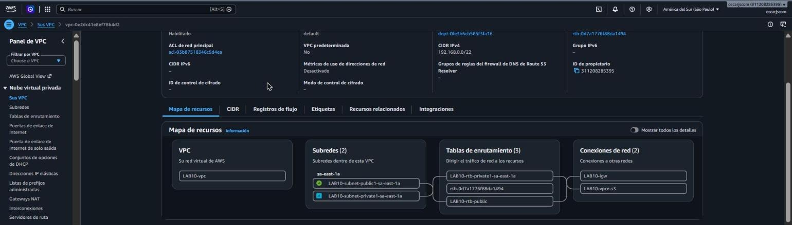
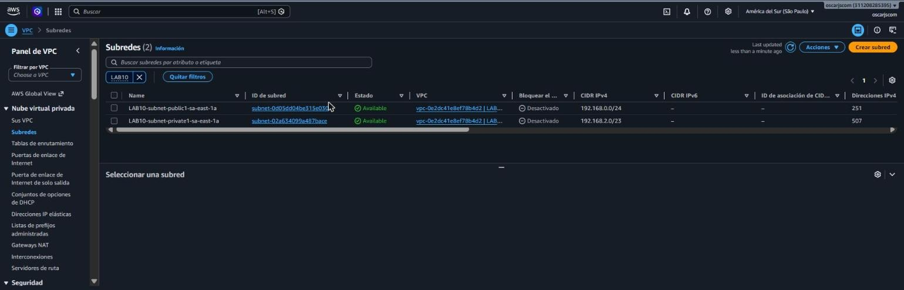
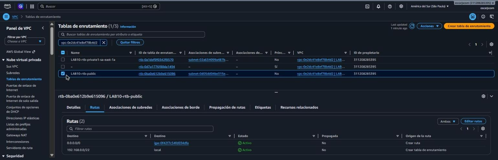
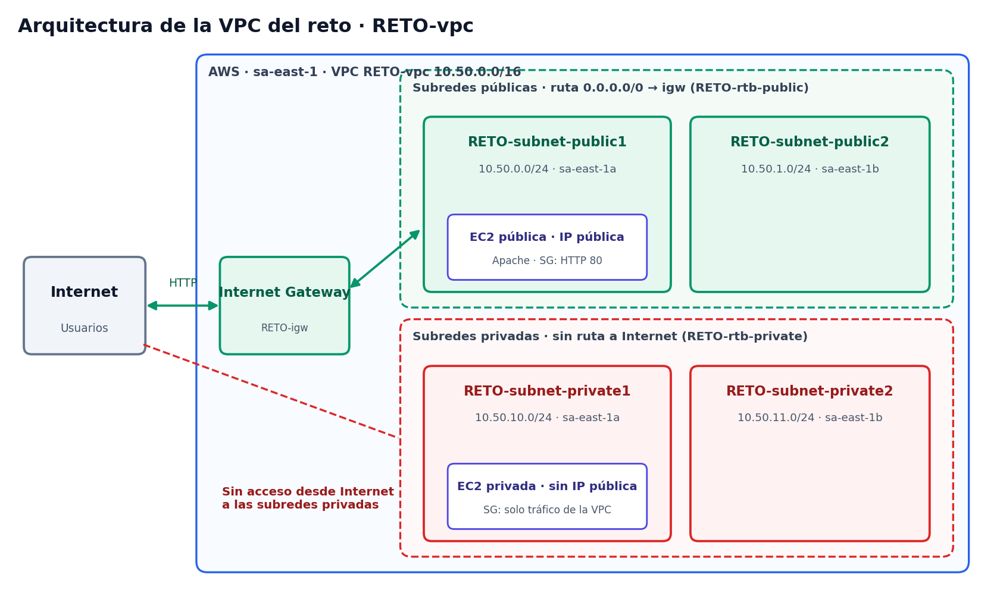
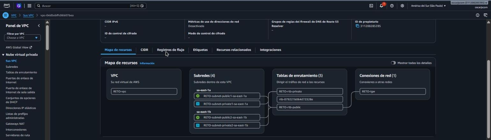
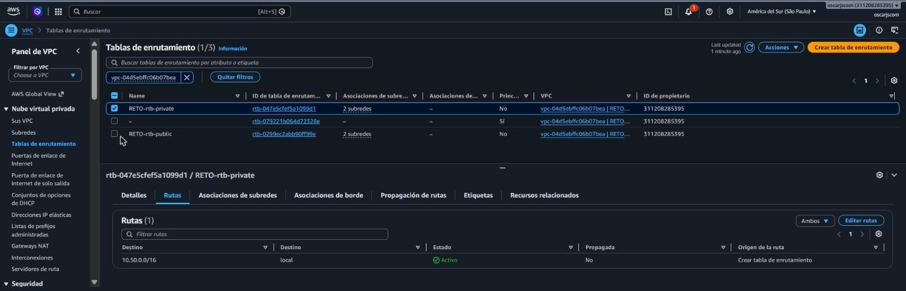
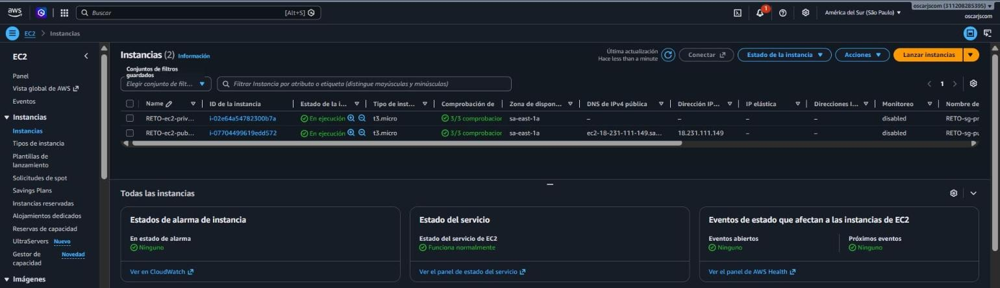
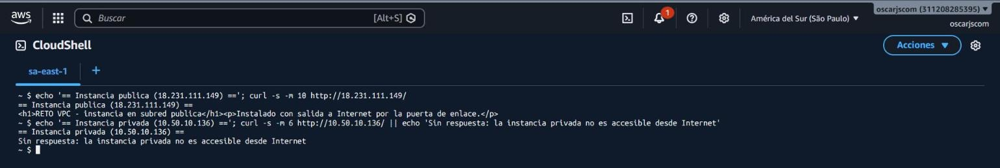

# Semana 10 — VPC

**Laboratorio GLAB-S10:** red virtual en AWS con subredes públicas y privadas, hecha desde la consola.

| | |
|---|---|
| **Alumno** | Oscar Olano — [@oscarjscom](https://github.com/oscarjscom) |
| **Docente** | Jaime Farfán Madariaga |
| **Institución** | Tecsup — Departamento de Tecnología Digital |
| **Curso** | Desarrollo de Soluciones en la Nube — 5 C24 |

## Qué se hizo

**Parte 1: creación de la VPC**
- VPC `LAB10-vpc` en São Paulo con bloque `192.168.0.0/22`.
- Subred pública `192.168.0.0/24` y subred privada `192.168.2.0/23`, en una zona de disponibilidad.
- Puerta de enlace de Internet, punto de enlace de S3 y sin Gateway NAT.
- Revisión del mapa de recursos, subredes, tablas de enrutamiento, puerta de enlace, puntos de conexión y seguridad.

**Parte 2: reto**
- VPC `RETO-vpc` (`10.50.0.0/16`) con 2 zonas, 2 subredes públicas y 2 privadas.
- Las públicas salen a Internet por la puerta de enlace; las privadas no tienen ruta hacia Internet.
- Una instancia en subred pública que responde desde Internet y otra en subred privada que no responde.

Es un laboratorio de configuración: no hay código. Los recursos se eliminaron al terminar.

## Capturas

| | |
|---|---|
|  |  |
|  |  |
|  |  |
|  |  |
