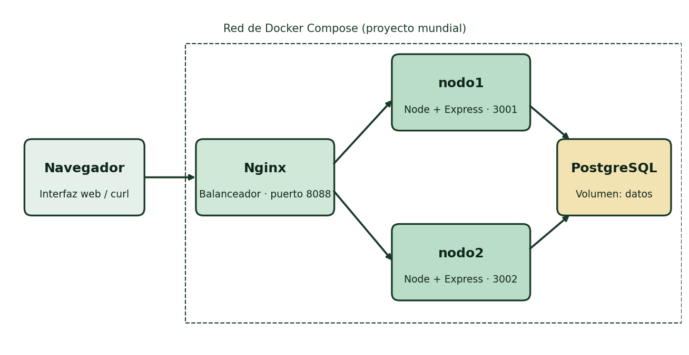
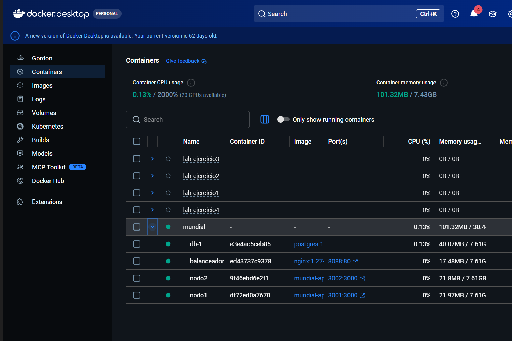
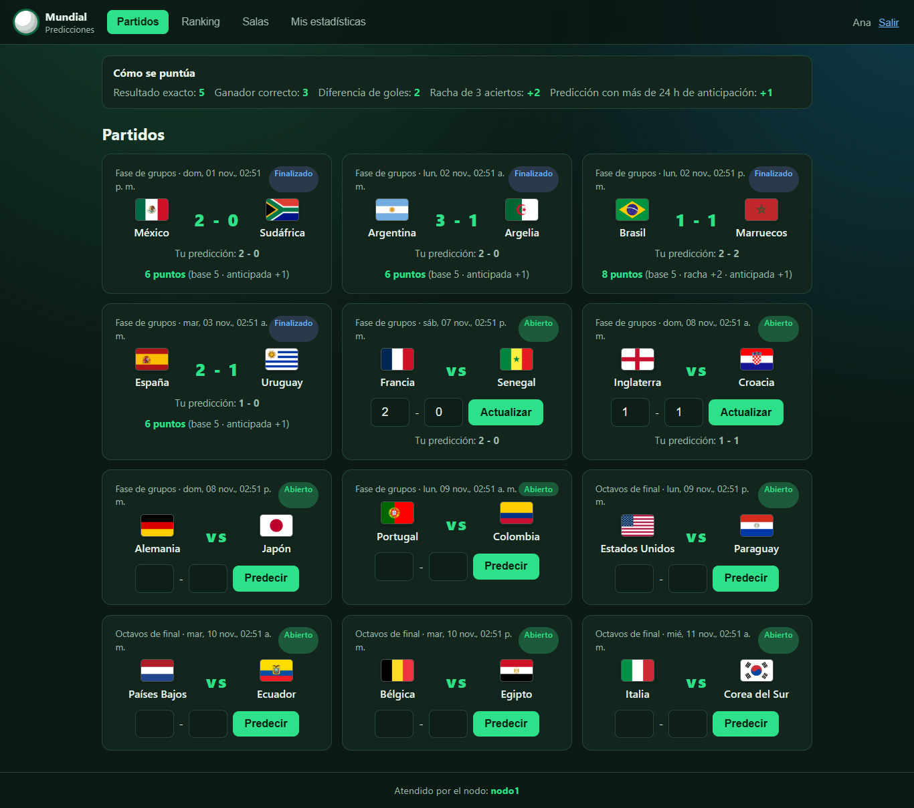
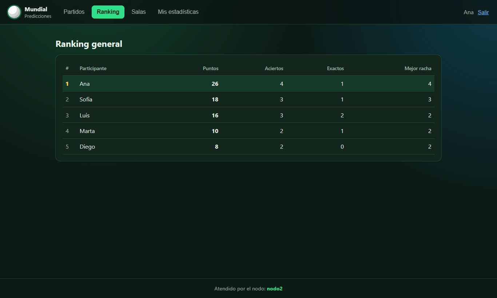
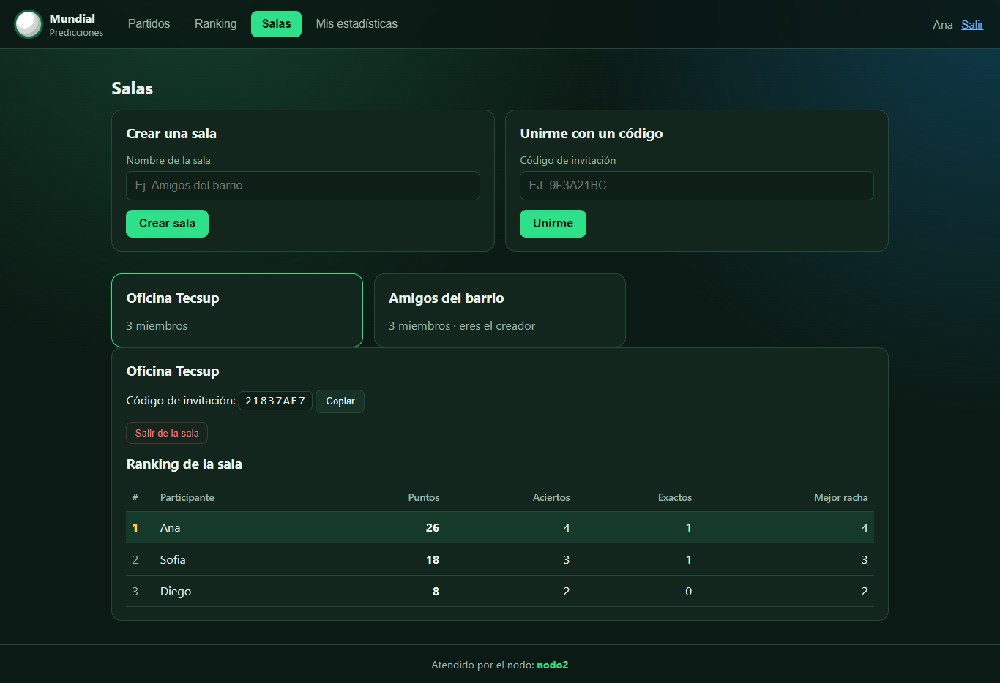
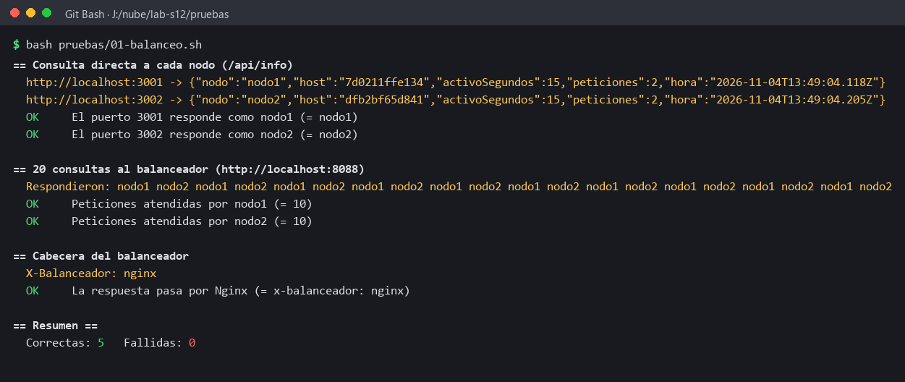
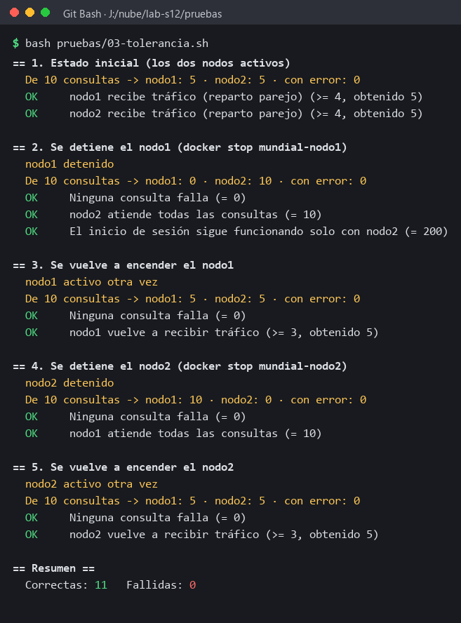
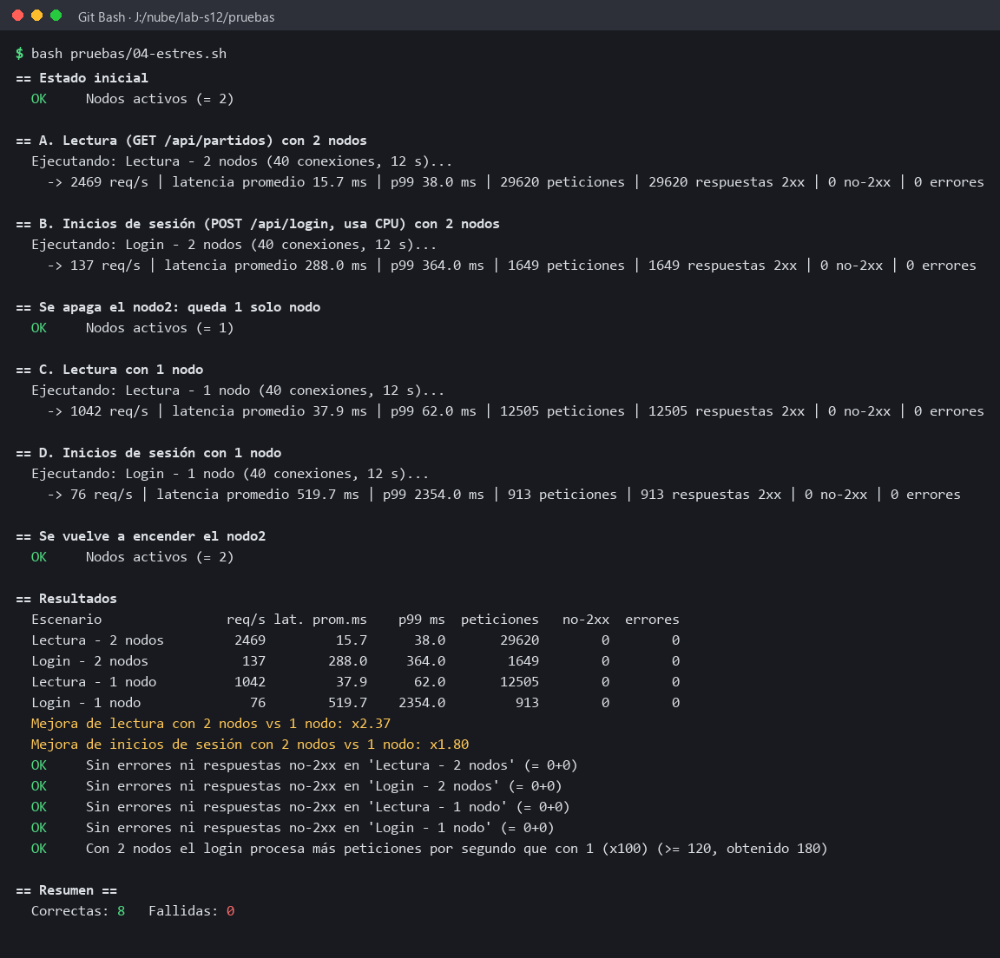

# Semana 12 — Despliegue de Instancias Virtualizadas

**Laboratorio calificado · Mundial – Predicciones:** predicciones de marcadores con puntaje, ranking y salas con invitación, desplegado en 2 nodos con balanceador.

| | |
|---|---|
| **Alumno** | Oscar Olano — [@oscarjscom](https://github.com/oscarjscom) |
| **Docente** | Jaime Farfán Madariaga |
| **Institución** | Tecsup — Departamento de Tecnología Digital |
| **Curso** | Desarrollo de Soluciones en la Nube — 5 C24 |

## Qué hace

- Los participantes predicen el marcador de cada partido y ganan puntos con 5 reglas: resultado exacto (5), ganador (3), diferencia de goles (2), racha de 3 aciertos (+2) y predicción anticipada (+1).
- Ranking general y estadísticas por participante.
- Salas privadas con código de invitación (renovar código, sacar miembros, salir, eliminar).
- Node.js + Express, PostgreSQL, 2 nodos idénticos y Nginx como balanceador, todo con Docker Compose.
- Informe con arquitectura y pruebas: [Informe_GLAB-S12.docx](Informe_GLAB-S12.docx). Video: [Video_Mundial_Predicciones.mp4](Video_Mundial_Predicciones.mp4).

## Capturas

| | |
|---|---|
|  |  |
|  |  |
|  |  |
|  |  |

## Resultado del estrés (40 conexiones, 12 s)

| Escenario | Req/s | Latencia prom. |
|---|---|---|
| Lectura, 2 nodos | 2469 | 15.7 ms |
| Lectura, 1 nodo | 1042 | 37.9 ms |
| Login, 2 nodos | 137 | 288 ms |
| Login, 1 nodo | 76 | 520 ms |

## Cómo ejecutarlo

```bash
cd "Semana 12 - Despliegue de Instancias Virtualizadas"
docker compose up -d --build
```

Abrir http://localhost:8088 (administrador: `admin` / `admin123`).

```bash
cd app && npm install && npm test   # pruebas unitarias del puntaje
bash pruebas/ejecutar-todo.sh       # balanceo, API, tolerancia y estrés
bash pruebas/demo-datos.sh          # datos de demostración
```
