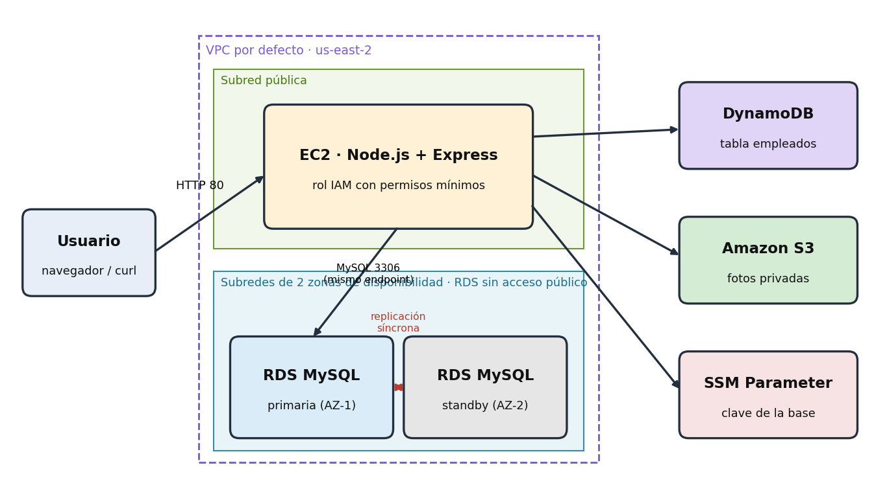
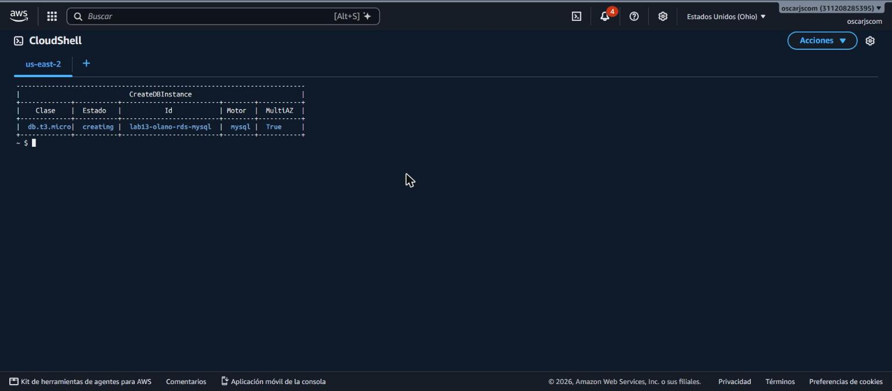
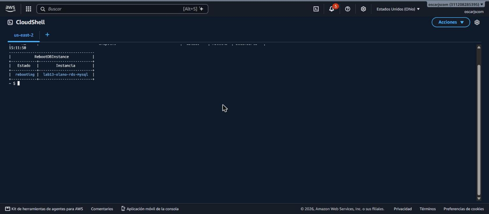
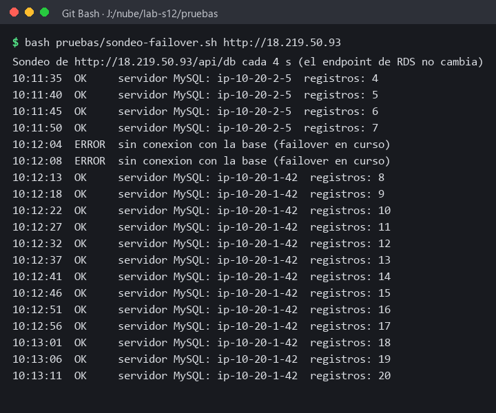
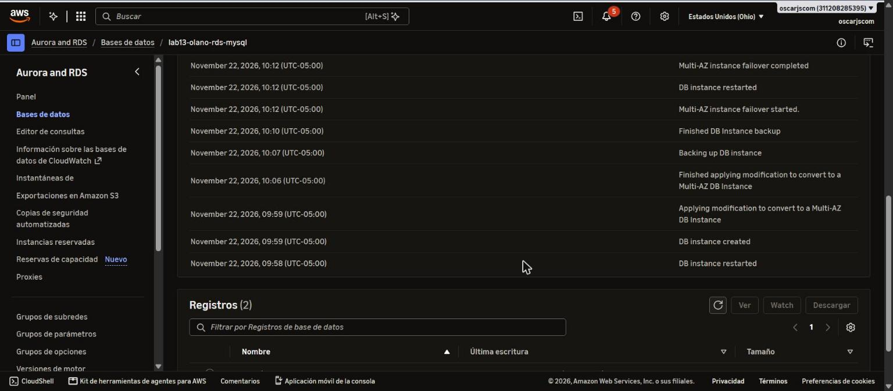
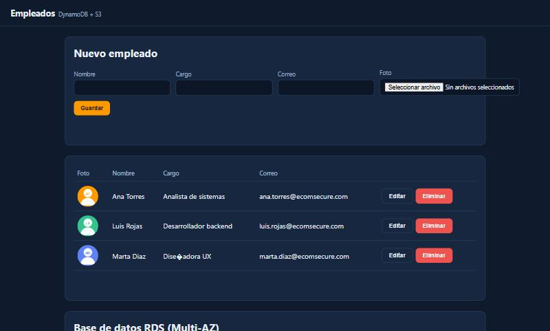
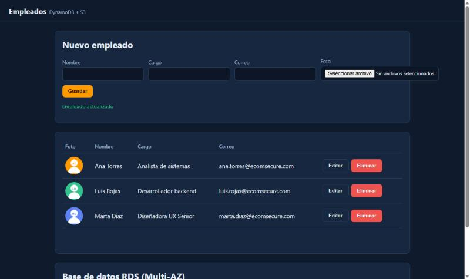
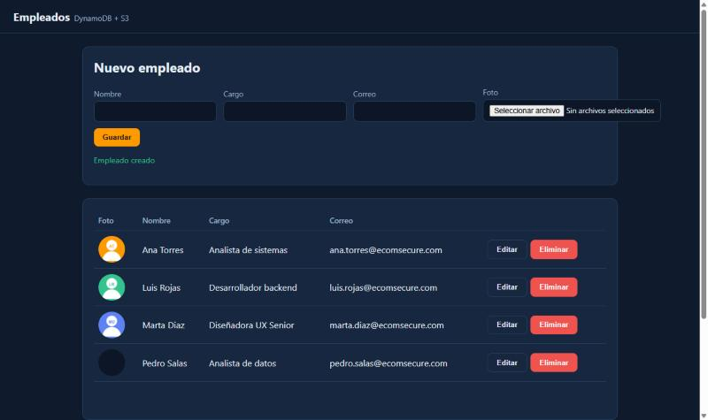
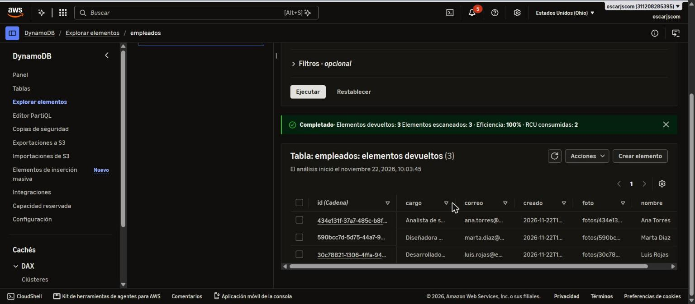
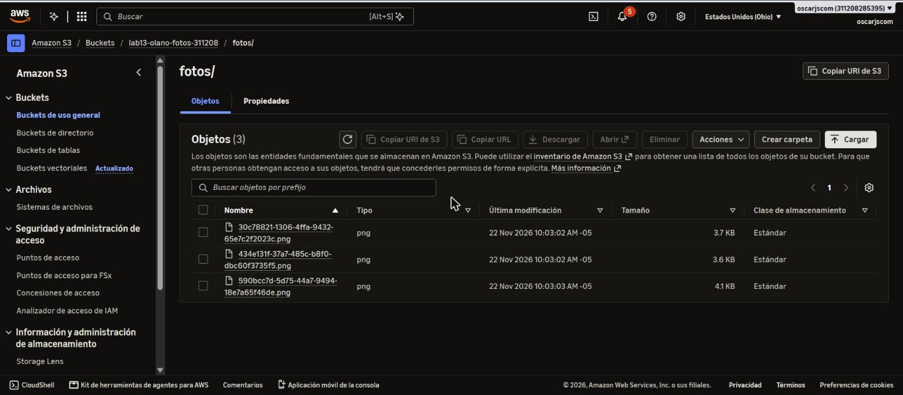

# Semana 13 — RDS failover y CRUD con DynamoDB

**Laboratorio calificado:** base de datos con failover en AWS (RDS Multi-AZ) y CRUD de empleados en DynamoDB con las fotos en S3.

| | |
|---|---|
| **Alumno** | Oscar Olano — [@oscarjscom](https://github.com/oscarjscom) |
| **Docente** | Jaime Farfán Madariaga |
| **Institución** | Tecsup — Departamento de Tecnología Digital |
| **Curso** | Desarrollo de Soluciones en la Nube — 5 C24 |

## Qué hace

- RDS MySQL en modo Multi-AZ: una primaria y una réplica en otra zona. Al forzar el failover, la aplicación volvió a conectarse sola por el mismo endpoint en unos 13 segundos y sin perder datos.
- Aplicación Node.js + Express en una EC2 con un CRUD de empleados: los datos van a DynamoDB y la foto a un bucket privado de S3 (se muestra con URL firmada).
- La EC2 usa un rol de IAM con permisos mínimos; la clave de la base está en Parameter Store, no en el código.
- Informe: [S13_Oscar_Olano_RDS_Failover_DynamoDB.docx](S13_Oscar_Olano_RDS_Failover_DynamoDB.docx).

## Capturas

| | |
|---|---|
|  |  |
|  |  |
|  |  |
|  |  |
|  |  |

## Cómo ejecutarlo

```bash
cd app
npm install
BUCKET=<bucket-de-fotos> TABLA=empleados PORT=3000 \
DB_HOST=<endpoint-rds> DB_USER=admin DB_NAME=empleadosdb DB_PASS=<clave> npm start
```

Las credenciales de AWS las toma de variables de entorno o del rol de la EC2; no se guardan en el código. La prueba de failover está en `pruebas/sondeo-failover.sh`.
