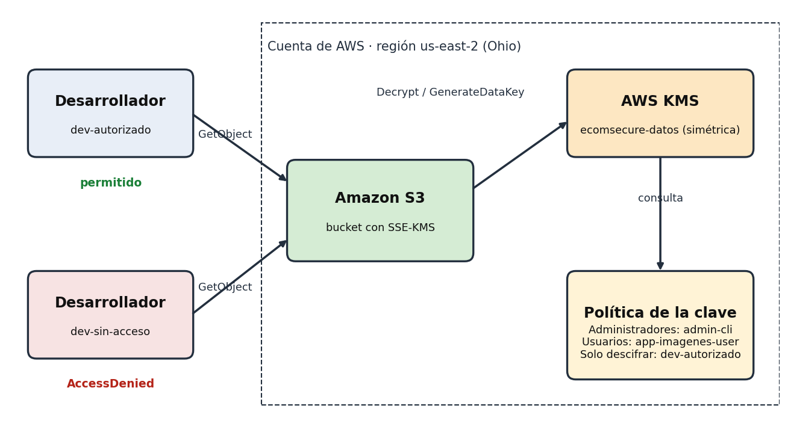
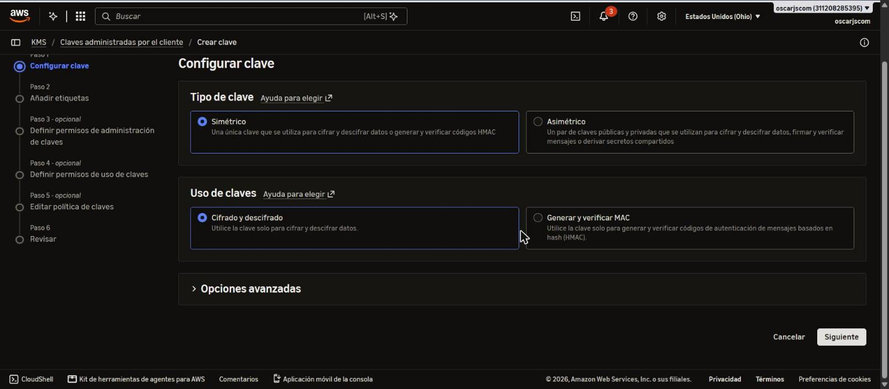
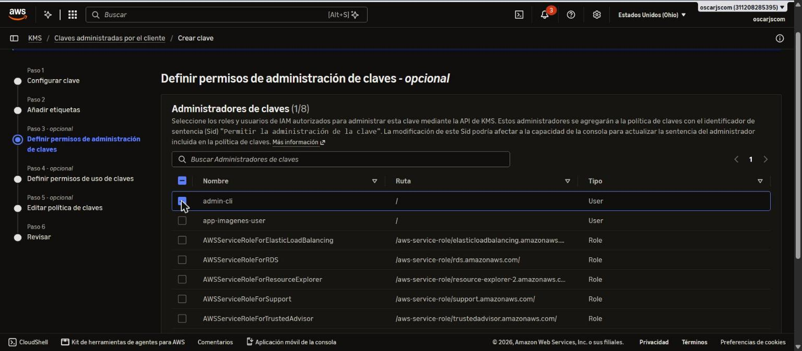
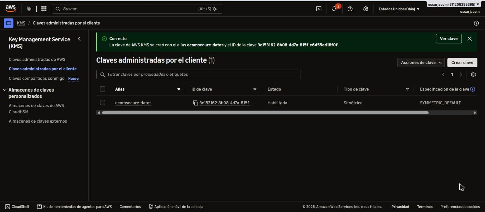
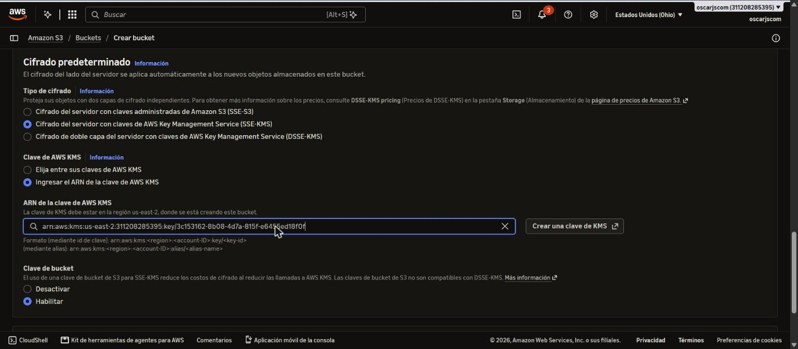
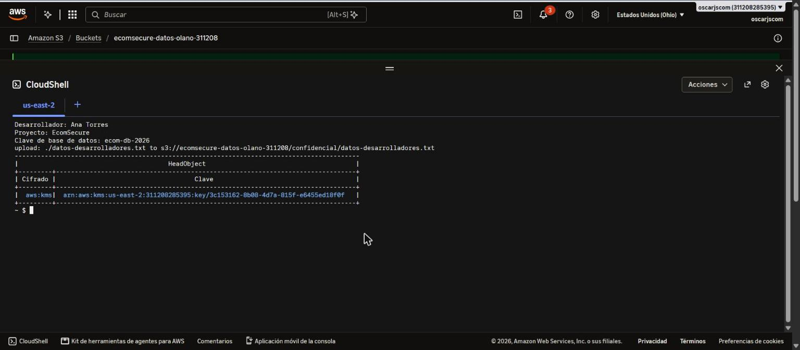
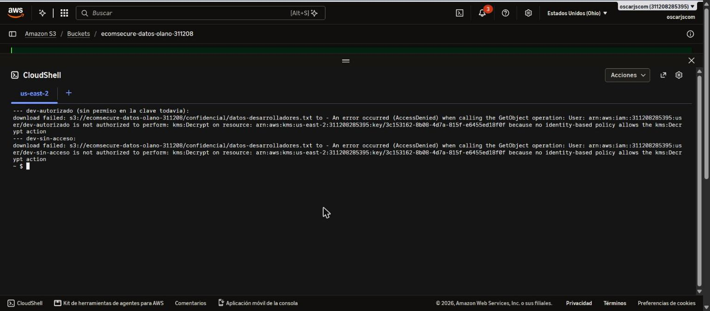
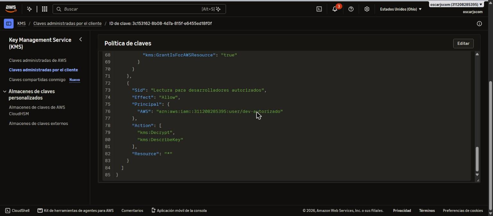
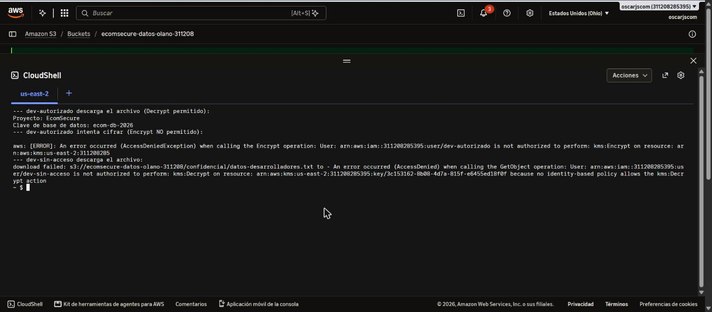
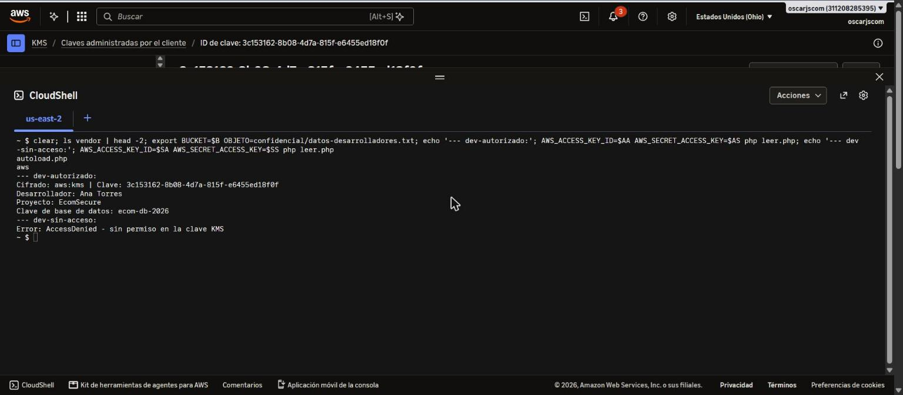

# Semana 14 — Seguridad en servicios AWS

**Laboratorio · EcomSecure:** cifrado de datos sensibles en S3 con AWS KMS y control de acceso a la clave.

| | |
|---|---|
| **Alumno** | Oscar Olano — [@oscarjscom](https://github.com/oscarjscom) |
| **Docente** | Jaime Farfán Madariaga |
| **Institución** | Tecsup — Departamento de Tecnología Digital |
| **Curso** | Desarrollo de Soluciones en la Nube — 5 C24 |

## Qué hace

- Clave simétrica de KMS (`ecomsecure-datos`) con administrador y usuarios definidos en su política.
- Bucket de S3 con cifrado SSE-KMS: cada objeto que se sube queda cifrado con esa clave.
- Permisos de mínimo privilegio: un desarrollador solo puede descifrar y otro no tiene acceso (AccessDenied).
- Script PHP (`leer.php`) que lee el objeto con el SDK de AWS, con credenciales por variables de entorno.
- Informe: [S14_Oscar_Olano_Cifrado_KMS_S3.docx](S14_Oscar_Olano_Cifrado_KMS_S3.docx).

## Capturas

| | |
|---|---|
|  |  |
|  |  |
|  |  |
|  |  |
|  |  |

## Cómo ejecutar el script

```bash
composer require aws/aws-sdk-php
export BUCKET=<nombre-del-bucket> OBJETO=confidencial/datos-desarrolladores.txt
export AWS_ACCESS_KEY_ID=<clave> AWS_SECRET_ACCESS_KEY=<secreto>
php leer.php
```

Las credenciales nunca se escriben en el código ni se suben al repositorio.
